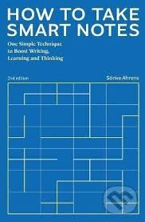

## Foreword

Back in the summer I had the idea of writing reports of a sort. This site exists partly because of that idea. Since I read papers anyway, it would only make sense to put my breakdowns, analysis or reflections on them into some written form. I admit the idea is not mine: I came across it in [How to Take Smart Notes](https://books.google.com/books/about/How_to_Take_Smart_Notes.html?id=wzv9zgEACAAJ) by Sönke Ahrens.

Later, after talking it over in my logic sessions with my mentor, I realised that pretty much any more or less systematic work involves reflection. And one of the best ways to reflect is exactly this kind of, so to speak, writing work. Only once we say something out loud or put it on paper do we really feel the difference between *"I think I know"* and **"I know that I know"**. That said, even these phrases carry quite a few suppressed premises worth unpacking (see [What is this thing called Knowledge?](https://www.routledge.com/What-is-this-thing-called-Knowledge/Pritchard/p/book/9781032410692), Duncan Pritchard, chapter 4).

Still, these breakdowns serve two goals for me:

1. The first one I have already partly voiced above.
2. To shore up the fundamental, engineering side of my CS.

After three years at university I realised that the time that is ideal for studying and building a really strong foundation was, to put it simply, blown on other things. In particular, most of my energy went into looking for a job, and, as everyone knows, in the pre-AI era not much was asked of a developer: understand HTTP methods, bean initialisation, a couple of things from [Spring](https://spring.io/), and voilà, you are earning above minimum wage while honestly understanding nothing about how [Nagle's algorithm](https://en.wikipedia.org/wiki/Nagle%27s_algorithm) in TCP collides with [delayed ACK](https://en.wikipedia.org/wiki/TCP_delayed_acknowledgment) and why RPC calls in your distributed system suddenly pick up an extra 40 ms of latency :) But time goes on, the industry changes, and work changes along with it. Having grown up a little, I realised that I want to build projects I am not ashamed of: projects that are satisfying by the very fact of their complexity. Engineering is about solving problems, hard ones included. And solving hard problems and getting into the nuances, as it turned out, really does require knowing the CS fundamentals. So right now I am at the point of the journey where I have to read papers, close basic gaps, and sometimes learn things from scratch.

That is why, for the papers I care about, especially once I have collected a fair amount of notes on them, I decided to publish breakdowns. The next one, proudly numbered 1.0, will be about AQS: [The java.util.concurrent Synchronizer Framework](https://gee.cs.oswego.edu/dl/papers/aqs.pdf) (Doug Lea).
